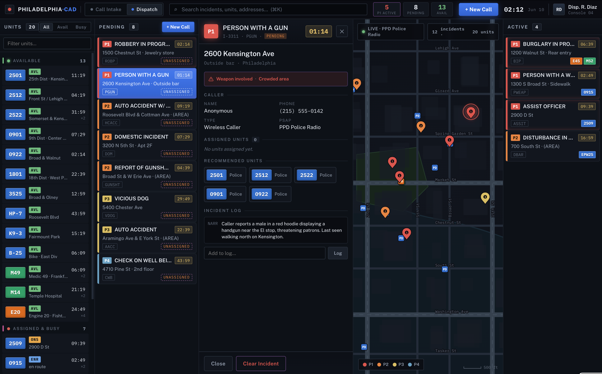
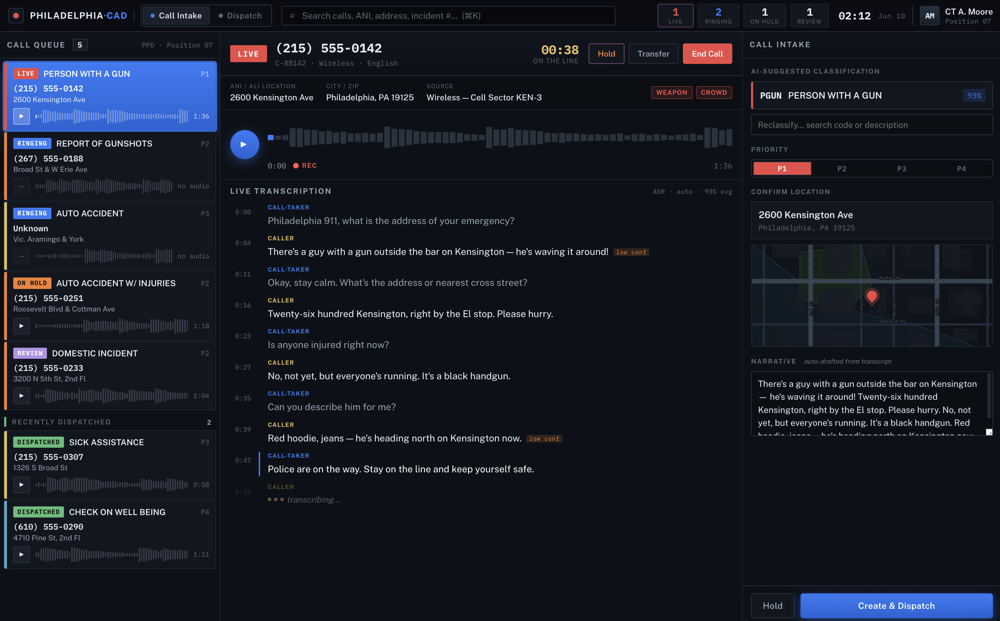
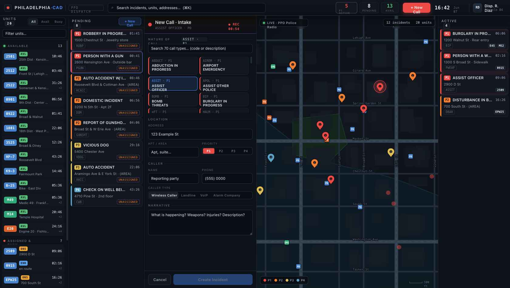

# Radio Intelligence Platform

**A real-time radio monitoring, transcription, and computer-aided dispatch (CAD) platform for trunked public-safety radio systems.**

The Radio Intelligence Platform ingests audio from trunked radio systems the instant a transmission ends, transcribes it automatically, normalizes the result into structured operational language, and surfaces it through a live dispatch console and an incident-detection engine. It runs as a containerized service alongside an existing software-defined-radio decoder and requires no additional infrastructure.

> This repository is a public capability and architecture overview. The application source is maintained in a private repository.

---



---

## Overview

| | |
|---|---|
| **Architecture** | Two-service container topology sharing a recordings volume |
| **Runtime** | Node 22 (Express + Socket.IO) with a React (Vite) front end served from a single process |
| **Datastore** | Embedded SQLite via Node's native `node:sqlite` — no external database server |
| **Transcription** | Pluggable ASR (ElevenLabs Scribe, Deepgram Nova, OpenAI Whisper), switchable at runtime |
| **Intelligence** | Transcript normalization, geocoded incident extraction, and ML-assisted optimization |
| **Transport** | Socket.IO push delivery — sub-second propagation to every connected client |
| **Security** | Session authentication, per-feed API keys, read-only and kill-switch operational modes |

---

## Capabilities

### Real-Time Audio Ingestion & Playback
- Transmissions are delivered to the browser and begin playback in arrival order the moment a call ends — no polling, no manual refresh.
- A single shared audio engine guarantees deterministic queue playback with no duplication or race conditions across browser tabs.
- Per-clip waveform rendering with click-to-seek, variable playback speed, and full keyboard transport control.
- Infinite-scroll clip queue with live full-text transcript search and radio-unit ID search.

### Automatic Speech Recognition
- Pluggable transcription backend supporting **ElevenLabs Scribe**, **Deepgram Nova**, and **OpenAI Whisper**, selectable at runtime without a service restart.
- An in-process worker queue decouples transcription latency from the upload path, ensuring ingestion is never blocked.
- Every raw ASR result is retained alongside its normalized form to support downstream quality analysis.

### Transcript Normalization
- A dedicated post-processing stage converts raw ASR output into operational language: spoken number words to digits, ordinal street addresses, district and precinct designations, unit identifiers, license-plate phonetics, and disposition phrasing.
- Normalization rules are deterministic and auditable, and can be tuned per deployment.

### Incident Intelligence & Computer-Aided Dispatch
- An incident-detection engine correlates related transmissions into structured incidents and presents them in a four-column CAD layout with an integrated map.
- ML-assisted extraction identifies incident type, location, and narrative from normalized transcripts, with geocoding against open geocoding services.
- **Geofencing** constrains detection and geocoding to operator-defined boundaries; **per-talkgroup geographic context** further scopes extraction to each talkgroup's coverage area.
- **Unit identity resolution** links subsequent transmissions to an open incident using both radio IDs and spoken call signs, while excluding dispatcher radios to prevent false correlation.
- A correction workbench lets operators amend incident details; each correction becomes deterministic learning applied immediately.

### ML-Assisted Optimization
- An optimization engine analyzes retained transcriptions and recommends learned keywords, address aliases, incident-type mappings, and configuration adjustments.
- Each optimization run is recorded with its prompt, sample set, model, and result for full traceability.

### Talkgroup Management
- Color-coded talkgroup tiles classified by agency type, with tag-first discrimination for correct classification of nested categories.
- Live active-transmission indicators, emergency-state flashing, inline alias editing, and per-talkgroup or bulk muting.

### Alerting & Notification
- Keyword alerting with a full-screen emergency overlay, configurable alert audio, and one-click keyword presets.
- **Paging-tone detection** analyzes each clip with a bandpass filter and fires *before* transcription — typically within one second of upload.
- Telegram delivery of emergency events, keyword matches, and tone detections, with optional audio attachment.

### Multi-System & Distributed Feeds
- Per-system configuration overlays allow incident sources, filtering, and learned data to differ between radio systems within a single deployment.
- Scoped API keys authenticate remote decoder operators, binding each feed to a specific system.

### Operations & Diagnostics
- Live streaming of decoder output and ingestion arguments directly to the browser, with per-call RF error and spike counts.
- In-browser editing and live restart of the decoder configuration.
- **Operational modes** — a **read-only mode** that rejects all mutating operations, an **authentication-bypass mode** for restricted display deployments, and a **kill switch** that gates ingestion and pauses the decoder from the console.

### Security & Access Control
- Full-application session authentication, enforced server-side across all API and audio endpoints.
- Rate-limited authentication, same-origin CORS enforcement in production, and optional per-upload key validation.

---

## Screenshots

| Call intake | Incident map |
|---|---|
|  |  |

---

## Architecture

See [docs/ARCHITECTURE.md](docs/ARCHITECTURE.md) for the full processing pipeline and service topology.

```
Decoder → ingestion → transcription → normalization → incident detection → live console
```

---

## Technology Stack

- **Backend** — Node 22, Express, Socket.IO, native `node:sqlite`, ffmpeg
- **Frontend** — React, Vite, Leaflet
- **ASR** — ElevenLabs Scribe, Deepgram Nova, OpenAI Whisper
- **Geocoding** — Nominatim, Photon
- **Packaging** — Docker, Docker Compose

---

## Related Project

[SDR Scanner Platform](https://github.com/justinalinn/sdr-scanner-platform) is the real-time C++20 acquisition and signal-processing system: wideband sweep planning, adaptive detection, multichannel VFOs, digital protocol analysis, physical-emitter fingerprinting, and predictive scheduling. Its public repository contains a capability, architecture, and validation overview while the application source remains private.

---

## License

MIT
